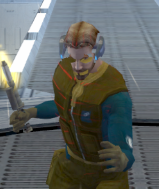
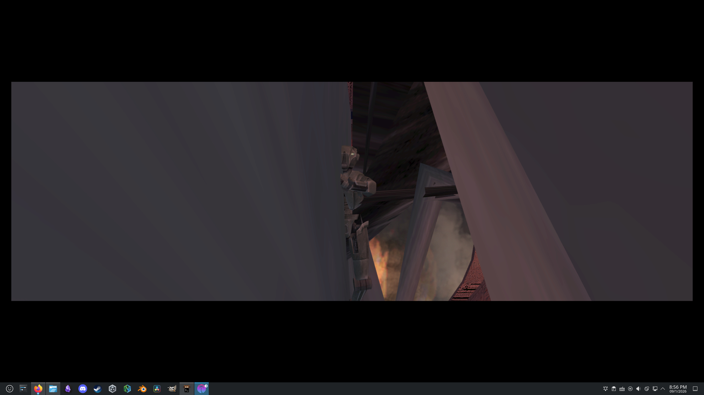
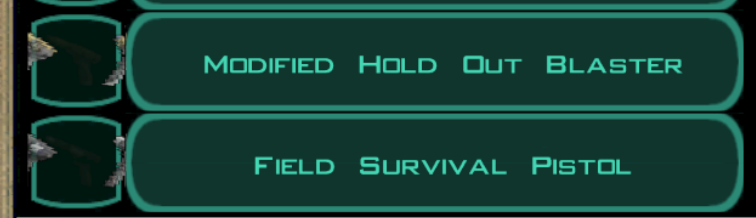

# Kotor 2 Switch Modding Guide
#### By VeSeeker

## 1 Introduction
#### You don't have to read this, but you may have questions if you don't

This guide is based on the neocities [KOTOR 2 Full Build for PC](https://kotor.neocities.org/modding/mod_builds/k2/full). I have gotten the vast majority of the mods in that build working on the Switch. You will need a modded Switch [running custom firmware](https://switch.hacks.guide/), or an emulator.

Beyond the need for a modded Switch, there are a few things that make modding Kotor on the Switch more difficult. One thing is that the Switch version shipped with a lot of `.tpc` texures in it's override folder. Any modded `.tga` or `.dds` file will not override those files unless we convert them to `.tpc`. My [modding tool](https://github.com/VeSeeker/kotor-switch-modding-tool) handles this.

On the topic of textures, many of the mods we will install use 4k textures. Although quite the visual improvement, they end up causing [5.1 Out of VRAM](#51-out-of-vram). The solution to this that I use is to downscale all the 4k textures by 50%. You could probably min-max this by only downscaling half of them or something, but I don't feel like it would be worth it. My modding tool also takes care of downscaling textures. If you are worried about the quality loss, don't be. The 2k textures are still a massive improvement over the originals. Some modules get extremely close to the VRAM limit, so follow this guide closely.

## 2 Setup
#### You really do need to read this part

You should download the latest release of my [modding tool](https://github.com/VeSeeker/kotor-switch-modding-tool).

Some mods need files from the base game in order to successfully install. You can do this through the Switch with [nxdumptool](https://github.com/DarkMatterCore/nxdumptool), or through an emulator (which I think is easier).

I will annotate mod names based on their installation process as compared to the neocities guide:

Normal installation
~~Mod not working on the Switch~~

I made a few '[patches](https://www.mediafire.com/folder/40ihkqn3tezon/Patches)' to make mods work on the Switch. What these actually are for the most part is just `.txi` files from the base game that aren't included in the mod files.

Finally, many mods use the TSLPatcher. Sometimes, this patcher is set to automatically detect your Kotor install. You'll need to change that setting [2.1.2 TSLPatcher automatic installation detection](#212-tslpatcher-automatic-installation-detection) if you have the PC version of the game installed (or even if you've had it installed before and the folder still exists). I'll include in the installation instructions if that mod's TSLPatcher automatically detects or not

### 2.1 Tools

#### 2.1.1 Kotor Switch Modding Tool

Download [here](https://github.com/VeSeeker/kotor-switch-modding-tool). This is a really cool tool that I wrote. It is a rewrite of DrSnuggly's [kotor-ii-switch-modding](https://github.com/DrSnuggly/kotor-ii-switch-modding). It's a bit faster, includes automatic downscaling, and *should* work on Windows, Mac, and Linux.

The repository has more detailed information, so check there if you have any questions. To get started, download the latest release and extract the folder somewhere convienient. Open a terminal in that folder and run `ksmt initialize 2`. That should create the folder `kotor-switch-modding-tool/K2romfs`. This is the folder you will be installing all of your mods into.

#### 2.1.2 TSLPatcher automatic installation detection

Simply change 'LookupGameFolder' from 1 to 0 in the patcher `.ini`. It is normally called `changes.ini` and is located in the tslpatchdata folder. If it is called something different, I will include that in the mod's installation instructions.

## 3 Mods

### 3.1 Switch Texture Restoration

- **Author:** jacqylfrost
- **Download:** [Mod](https://deadlystream.com/files/file/2103-kotor-switch-texture-restoration)
- **Method:** Loose-file\
**Installation instructions:** Extract the texture files into override, not a subfolder

---
### 3.2 ~~3C-FD Patcher~~

- **Author:** J
- **Download:** [Mod](https://deadlystream.com/files/file/2734-fog-fix-more-3c-fd-patcher/)
- **Method:** Executable\
**Installation instructions:** We fix the Aspyr patch through [3.157 IPS Patches](#3157-ips-patches)

---
### 3.3 Water Restoration

- **Author:** J
- **Download:** [Mod](https://deadlystream.com/files/file/2758-water-restoration/)
- **Method:** Loose-file
---
### 3.4 Stutter Fix

- **Author:** J
- **Download:** [Mod](https://deadlystream.com/files/file/2699-stutter-fix-and-force-cage-update/)
- **Method:** Loose-file\
**Download instructions:** If you want both the fix and the new force cage model, download just forcecage_updated_1.1.0.zip\
---
### 3.5 ~~4GB Patcher~~

- **Author:** Daniel Pistelli
- **Download:** [Mod](https://ntcore.com/?page_id=371)
- **Method:** Executable\
**Installation instructions:** There is no `.exe` to patch lol

---
### 3.6 TSLRCM & Switch Patch

- **Author:** zbyl2, DarthStoney, Hassat Hunter & VarsityPuppet, Switch Patch by VeSeeker
- **Download:** [Mod](https://deadlystream.com/files/file/578-tsl-restored-content-mod/) [Switch dialog.tlk](https://gbatemp.net/threads/knights-of-the-old-republic-ii-switch-modding.635861/) [Switch Patch](https://www.mediafire.com/file/ilpo07v3a7nmliu/TSLRCM_Switch_Patch.zip/file)
- **Method:** Executable, Loose-file\
**Installation instructions:** After installing the mod, replace dialog.tlk in `K2romfs` with the one linked above. Then extract the 2 .bik files from the Switch Patch into `K2romfs/Movies/`

---
### 3.7 TSLRCM Tweak Pack

- **Author:** Pavijan (update by Fair Strides)
- **Download:** [Mod](http://deadlystream.com/files/file/296-unofficial-tslrcm-tweak-pack/)
- **Method:** Multi-Run TSLPatcher\
**Installation instructions:** Don't use the complete installer, instead selecting the individual component installer—this is critical for compatibility, not just to choose specific options. The installer for this mod will need to be run 6 times, once to install each of the options we'll be using: Kaevee Removal Parts 1 & 2, Saedhe's Head, Kreia-Atris Dialogue Tweak, Trayus Mandalore Conversation, and Trayus Sith Lord Masks. Most of the other options for this mod are untested with the mod builds, but will likely function--I still recommend against using them, since compatibility isn't 100% guaranteed, but you can try. The one exception is Atton at the End, which is completely incompatible with one of the most important mods in this build, which is a much more comprehensive implementation of Atton's dialogue at endgame.

---
### 3.8 Silent Sion

- **Author:** Emperor Devon
- **Download:** [Mod](https://deadlystream.com/files/file/2426-silent-sion-restoration/)
- **Method:** Loose-File\
**Installation instructions:** Move just 153sion.dlg to the override.

---
### 3.9 Thematic KOTOR 2 Companions

- **Author:** Sniggles & JCarter426
- **Download:** [Mod](https://deadlystream.com/files/file/2662-thematic-kotor-2-companions/)
- **Method:** TSLPatcher\
**Installation instructions:** If you would like to have Visas's class as Sith Assassin, install the "Standard + Sith Assassin Visas" option. Otherwise, simply install "Standard."

---
### 3.10 Saving Throw Fixes

- **Author:** Rovan
- **Download:** [Mod](http://deadlystream.com/files/file/828-tsl-prestige-class-saving-throw-fixes/)
- **Method:** Loose-file\
**Installation instructions:** I advise users to only install the Jedi Master/Sith Lord fixes.

---
### 3.11 Classic Class Attack

- **Author:** Crimson Knight
- **Download:** [Mod](https://deadlystream.com/files/file/2812-classic-class-attack-bonus/)
- **Method:** TSLPatcher\
**Installation instructions:** Strongly recommend downloading the standard option. Weaker Consulars can be extremely punishing, so if you choose this option be aware that you're in for a rough time at some places!

---
### 3.12 Robes with Shadows

- **Author:** PapaZinos
- **Download:** [Mod](https://deadlystream.com/files/file/2075-robes-with-shadows-for-tsl/)
- **Method:** Loose-file\
**Installation instructions:** Extract the mod. Ignore the included subfolders, and move just the files in the base folder to your override. Overwrite when prompted.

---
### 3.13 K2CP

- **Author:** Multiple; A Future Pilot, JCarter426 Curates
- **Download:** [Patch](https://deadlystream.com/files/file/1280-kotor-2-community-patch/)
- **Method:** TSLPatcher\
**Installation instructions:** After installing, delete P_HK47.mdl and .mdx. See [5.3 Model Problems](#53-model-problems)

---
### 3.14 Remote Tells Influence & Patch

- **Author:** tk102, patch by Leilukin
- **Download:** [Mod](https://www.gamefront.com/games/knights-of-the-old-republic-ii/file/remote-tells-influence) [Patch](https://www.dropbox.com/s/af3h6y793f3zjxq/Remote%20Tells%20Influence%20Patch%20for%20TSLRCM.zip?dl=0)
- **Method:** Loose-file & Patch
---
### 3.15 Better Czerka Salvager

- **Author:** OzilsEyes
- **Download:** [Mod](https://deadlystream.com/files/file/2576-fixed-better-czerka-salvager/)
- **Method:** TSLPatcher
---
### 3.16 Ultimate HR Textures

- **Author:** ShiningRedHD
- **Download:** [Mod](https://www.nexusmods.com/kotor2/mods/1100)
- **Method:** Loose-file\
**Installation instructions:** Download the .tpc variant of the mod. Delete PER_Gr01.tpc, TEL_rock.tpc through TEL_rock07.tpc, and TEL_wl05.tpc before moving the files to your override folder.

Delete or fix PER_Rk01, 02, TEL_Bra01, TEL_gr03. See [5.2 Texture Outlines](#52-texture-outlines)

---
### 3.17 Ultimate Character Overhaul

- **Author:** ShiningRedHD
- **Download:** [Mod](https://www.nexusmods.com/kotor2/mods/1060)
- **Method:** Loose-file\
**Installation instructions:** For now, ignore all patches (those will be installed later). Just download the main package. Just MAKE SURE they are in .tpc file format! Delete N_OndSoldMH1.tpc, PMBJ02.tpc, PMHC03.tpc, PMHC03D1.tpc, and PMHC03D2.tpc before moving to override.

---
### 3.18 Ultimate Nar Shaddaa

- **Author:** ShiningRedHD
- **Download:** [Mod](https://www.nexusmods.com/kotor2/mods/1101)
- **Method:** Loose-file\
**Installation instructions:** Download the .tpc variant of the mod. Delete NAR_fl01.tpc, NAR_Met4.tpc, and NAR_wl07.tpc before moving to your Override.

Delete or fix NAR_gar1, 2. See [5.2 Texture Outlines](#52-texture-outlines)

---
### 3.19 Ultimate Dantooine

- **Author:** ShiningRedHD
- **Download:** [Mod](https://www.nexusmods.com/kotor2/mods/1103)
- **Method:** Loose-file\
**Installation instructions:** Download the .tpc variant of the mod. Delete DAN_birds.tpc, DAN_MWFl.tpc, DAN_NEW1.tpc and DAN_wall03.tpc before moving to your Override.

Delete or fix DAN_leaf02, 03. See [5.2 Texture Outlines](#52-texture-outlines)

---
### 3.20 Ultimate Dxun & Patch

- **Author:** ShiningRedHD
- **Download:** [Mod](https://www.nexusmods.com/kotor2/mods/1105) [Patch](https://mega.nz/file/kUZTmT6K#9Ymj028VHivAoY7RaW1mKXu1H28NvYVNfM44p5C-IIM)
- **Method:** Loose-file\
**Installation instructions:** Download the .tpc variant of the mod. Delete DXN_BWa1 through DXN_BWa8.tpc before moving the files to your override folder, then apply the patch.

---
### 3.21 Ultimate Onderon

- **Author:** ShiningRedHD
- **Download:** [Mod](https://www.nexusmods.com/kotor2/mods/1102)
- **Method:** Loose-file\
**Installation instructions:** Download the .tpc variant of the mod. Delete OND_dor1.tpc & OND_dor3.tpc before moving to your Override.

---
### 3.22 Ultimate Korriban

- **Author:** ShiningRedHD
- **Download:** [Mod](https://www.nexusmods.com/kotor2/mods/1104)
- **Method:** Loose-file\
**Installation instructions:** Download the .tpc variant of the mod. Delete KOR_water01.tpc before moving the files to your override folder.

---
### 3.23 Ultimate Malachor

- **Author:** ShiningRedHD
- **Download:** [Mod](https://www.nexusmods.com/kotor2/mods/1106)
- **Method:** Loose-file\
**Installation instructions:** Download the .tpc variant of the mod. For this mod only, do not overwrite if prompted!

---
### 3.24 Korriban Sith Art

- **Author:** MessesWithWolves
- **Download:** [Mod](https://www.nexusmods.com/kotor/mods/1632)
- **Method:** Loose-file\
**Download instructions:** Download and install both files.\
---
### 3.25 Ritual and Water Textures

- **Author:** Nehua
- **Download:** [Mod](https://deadlystream.com/files/file/2286-freedon-nadds-tomb-ritual-and-water-textures/)
- **Method:** Loose-file\
**Installation instructions:** Move only the files from the ritual folder, not the water.

---
### 3.26 PFHC06 Fix

- **Author:** Ferc Kast
- **Download:** [Mod](https://deadlystream.com/files/file/1442-pfhc06-fix/)
- **Method:** Loose-file
---
### 3.27 Droid Special Weapons Fix

- **Author:** LoneWanderer
- **Download:** [Mod](https://deadlystream.com/files/file/1860-droid-special-weapons-fix-for-tsl-v10/)
- **Method:** TSLPatcher\
**Download instructions:** Use the V2 version of the mod.\
---
### 3.28 Honest Merchant

- **Author:** TK-664
- **Download:** [Mod](https://deadlystream.com/files/file/1904-honest-merchant-tslrcm/)
- **Method:** TSLPatcher\
**Installation instructions:** [2.1.2 TSLPatcher automatic installation detection](#212-tslpatcher-automatic-installation-detection)

---
### 3.29 JC's Minor Fixes

- **Author:** JCarter426
- **Download:** [Mod](https://deadlystream.com/files/file/1215-jcs-minor-fixes-for-k2/)
- **Method:** Loose-file\
**Installation instructions:** If you are using the K2 Community Patch, install the contents of every folder but Straight Fixes (that was already in the K2CP). Delete DXn_grassfx.tga and DXN_jungfx.tga in Aesthetic Improvements before moving files to override.

---
### 3.30 Maintenance Reskin

- **Author:** Malkior
- **Download:** [Mod](https://deadlystream.com/files/file/165-maintenance-officer-realistic-reskin/)
- **Method:** Loose-file
---
### 3.31 HD Sign Placeable

- **Author:** Dark Hope
- **Download:** [Mod](https://deadlystream.com/files/file/2442-plc_sign/)
- **Method:** Loose-file
---
### 3.32 HD Kiosk & Patch

- **Author:** Dark Hope, patch by Marcus Ramikin
- **Download:** [Mod](https://deadlystream.com/files/file/2277-kiosk-hd/) [Patch](https://deadlystream.com/files/file/2910-kiosk-model-fix-for-k2/)
- **Method:** Loose-file\
**Download instructions:** Download the "Kiosk HD 15.03.2024" version.\
---
### 3.33 HD Desk

- **Author:** Dark Hope
- **Download:** [Mod](https://deadlystream.com/files/file/2441-plc_desk/)
- **Method:** Loose-file
---
### 3.34 Hires Beam Effects

- **Author:** InSidious
- **Download:** [Mod](http://deadlystream.com/files/file/221-hi-res-beam-effects/)
- **Method:** Loose-file
---
### 3.35 Fire and Ice HD

- **Author:** Cinder Skye
- **Download:** [Mod](http://deadlystream.com/files/file/454-fire-and-ice-hd-whee/)
- **Method:** Loose-file
---
### 3.36 Animated Energy Shields & Switch Patch

- **Author:** Dark Hope, Switch Patch by VeSeeker
- **Download:** [Mod](https://deadlystream.com/files/file/2193-animated-energy-shields/) [Switch Patch](https://www.mediafire.com/file/a7dwopmivrocajp/Animated_Energy_Shields_Switch_Patch.zip/file)
- **Method:** Loose-file\
**Installation instructions:** Install the main mod, then move the files from the Switch Patch into override.

---
### 3.37 Blaster Visual Effects

- **Author:** JCarter426
- **Download:** [Mod](https://deadlystream.com/files/file/1272-jcs-blaster-visual-effects-for-k2/)
- **Method:** Loose-file\
**Installation instructions:** Move everything from the override folder to your game's override directory, unless you would like yellow/green disruptors, in which case those files should be moved from the optional folder after moving all loose files to the override first.

---
### 3.38 Head Model Fixes

- **Author:** Redrob41
- **Download:** [Mod](http://deadlystream.com/files/file/489-tsl-head-model-fixes/)
- **Method:** Loose-file
---
### 3.39 New Holocron Textures

- **Author:** Sith Holocron
- **Download:** [Mod](http://deadlystream.com/files/file/283-new-texture-of-holocrons-in-the-telos-secret-academy/)
- **Method:** Loose-file
---
### 3.40 Thigh-High Boots for Twi'lek

- **Author:** DarthParametric
- **Download:** [Mod](http://deadlystream.com/files/file/1088-tsl-thigh-high-boots-for-female-twilek-body-modders-resource/)
- **Method:** Loose-file\
**Installation instructions:** Ignore the "Player Bodies" folder. Go into the NPC Replacement folder and move all the loose files to the override directory. Ignore the optional folder.

---
### 3.41 Better Twi'lek Heads

- **Author:** Ashton Scorpius
- **Download:** [Mod](https://deadlystream.com/files/file/1432-tsl-better-male-twilek-heads/)
- **Method:** HoloPatcher\
**Installation instructions:** Choose whether to use the slim or original necks; your preference.

---
### 3.42 Twi'lek Male Diversity

- **Author:** Leilukin
- **Download:** [Mod](https://deadlystream.com/files/file/2242-tsl-twilek-male-npc-diversity/)
- **Method:** HoloPatcher\
**Installation instructions:** Run the installer and install the Main Installation first. Once the main install is completed, select the optional upscaled textures install option and install it, if desired. If using the original necks option of Ashton Scorpius's Better Twi'lek Males mod, also ensure to run the "[Optional] Original Necks" install option.

---
### 3.43 Dahnis Unique Look

- **Author:** Leilukin
- **Download:** [Mod](https://deadlystream.com/files/file/2198-dahnis-unique-look/)
- **Method:** HoloPatcher\
**Installation instructions:** The use of the upscaled textures or not is your preference, though I recommend them.

---
### 3.44 Darth Malak's Armor

- **Author:** DarthParametric
- **Download:** [Mod](http://www.nexusmods.com/kotor2/mods/9/?)
- **Method:** Loose-file
---
### 3.45 Supermodel Fix

- **Author:** JCarter426
- **Download:** [Mod](https://deadlystream.com/files/file/1141-jcs-supermodel-fix-for-k2/)
- **Method:** Loose-file\
**Installation instructions:** Move the files from the override folder to your override directory. Optionally, if you prefer the aesthetic of the K1 running animation, you can also move the files from the 'K1 Style Running' folder to your override and overwrite.

---
### 3.46 Worn-Out Mando Armor

- **Author:** LordRevan999
- **Download:** [Mod](https://mega.nz/#!1A4RCLha!Ro2GNVUPRfgot-woqh80jVaukixr-cnUmTdakuc0Ca4)
- **Method:** Loose-file
---
### 3.47 HD NPC Portraits

- **Author:** ndix UR
- **Download:** [Mod](https://deadlystream.com/files/file/1770-hd-npc-portraits/)
- **Method:** Loose-file
---
### 3.48 HD PC Portraits

- **Author:** ndix UR
- **Download:** [Mod](https://deadlystream.com/files/file/1769-hd-pc-portraits/)
- **Method:** Loose-file
---
### 3.49 Stylized Portraits TSL

- **Author:** Tinman888 & Sdub
- **Download:** [Mod](https://deadlystream.com/files/file/1977-stylized-portraits-tsl-created-by-tinman888/)
- **Method:** Loose-file
---
### 3.50 PFHC03 Restoration

- **Author:** Effix
- **Download:** [Mod](https://deadlystream.com/files/file/2003-effixians-pfhc03-restoration/)
- **Method:** TSLPatcher\
**Installation instructions:** Recommend the 'zombie-like' appearance, as it matches vanilla DS transitions.

---
### 3.51 4K Atton

- **Author:** Constar
- **Download:** [Mod](http://deadlystream.com/files/file/441-4k-atton/)
- **Method:** Loose-file\
**Download instructions:** Download the .tpc version of the mod.\
---
### 3.52 Atton with Scruff

- **Author:** felixfelicitas
- **Download:** [Mod](http://deadlystream.com/files/file/528-atton-rand-with-scruff/)
- **Method:** Loose-file\
**Installation instructions:** Ignore the MacOS folder, only move the .TGA files.

---
### 3.53 Rounder G0-T0

- **Author:** dirigibalistic
- **Download:** [Mod](https://www.nexusmods.com/kotor2/mods/1296)
- **Method:** Loose-file
---
### 3.54 Dark Harbinger

- **Author:** NiuHaka
- **Download:** [Mod](https://mega.nz/#!kARxFSbS!wVaTMHT3LZ1Z2nFzjCiattphsim1p-0ReALIcb9h8pQ)
- **Method:** Loose-file\
**Installation instructions:** Choose which version of the head model you would like to use from the screenshots provided. Place the files from the corresponding folder into your override.

---
### 3.55 HD Vrook

- **Author:** Dark Hope
- **Download:** [Mod](https://deadlystream.com/files/file/1504-vrook-hd-international-global-mod/)
- **Method:** Loose-file
---
### 3.56 HD Darth Nihilus

- **Author:** Darth_Sapiens
- **Download:** [Mod](http://deadlystream.com/files/file/367-darth-sapiens-presents-hd-darth-nihilus/)
- **Method:** Loose-file\
**Download instructions:** Download and install the .tpc filetype version: it is nearly lossless, much more performant due to the smaller size, and critically fixes several issues caused by the very large texture size of the original upload.\
---
### 3.57 Darth Sion Remake

- **Author:** FF97
- **Download:** [Mod](https://deadlystream.com/files/file/1244-darth-sion-remake/)
- **Method:** Loose-file\
**Installation instructions:** Install the files within the Override folder.

---
### 3.58 Detran's Revan

- **Author:** Detran
- **Download:** [Mod](https://deadlystream.com/files/file/2350-detrans-darth-revan/#)
- **Method:** Loose-file
---
### 3.59 Lore-Friendly Mandalore

- **Author:** constantinople33
- **Download:** [Mod](https://deadlystream.com/files/file/1848-expanded-lore-friendly-mandalores-mask-with-matching-armor-and-icons-upscaled-high-quality-textures/)
- **Method:** Loose-file
---
### 3.60 Visas Reduced Model Clipping

- **Author:** Feeling
- **Download:** [Mod](https://deadlystream.com/files/file/2299-visas-reduced-model-clipping/)
- **Method:** Loose-file\
**Download instructions:** Either option is fine, choose which you prefer based on the screenshots.\
---
### 3.61 HD Visas Marr

- **Author:** Darth_Sapiens
- **Download:** [Mod](http://deadlystream.com/files/file/519-darth-sapiens-presents-hd-2k-visas-marr/)
- **Method:** Loose-file\
**Installation instructions:** Only move the four .dds filetype files to your override, ignore the remainder. If installing this mod alongside either the K2CP or Ultimate Character Overhaul, P_VisasBB.tpc, P_VisasH01.tpc/.tga, P_VisasHD01.tpc/.tga, and P_VisasHD02.tpc/.tga must be deleted from the override so this mod's .dds-based files will load.

---
### 3.62 Mira Unpoofed

- **Author:** Ashton Scorpius
- **Download:** [Mod](https://deadlystream.com/files/file/1733-tsl-mira-unpoofed/)
- **Method:** Loose-file
---
### 3.63 T3M4 HD 2K & Switch Patch

- **Author:** Darth_Sapiens, Switch Patch by VeSeeker
- **Download:** [Mod](http://deadlystream.com/files/file/514-darth-sapiens-presents-t3m4-hd-2k/) [Switch Patch](https://www.mediafire.com/file/ilpo07v3a7nmliu/TSLRCM_Switch_Patch.zip/file)
- **Method:** Loose-file\
**Installation instructions:** If present in your Override, P_t3m4_01.tpc/.tga must be deleted so this mod's .dds-based files will load.

Install the main mod, then move the files in the Switch Patch into override.

---
### 3.64 HD Astromechs & Switch Patch

- **Author:** Darth_Sapiens and Sith Holocron, Switch Patch by VeSeeker
- **Download:** [Mod](http://deadlystream.com/files/file/971-refurbished-astromech-droids/) [Switch Patch](https://www.mediafire.com/file/ovd9ttxt0bfiq7b/HD_Astromechs_Switch_Patch.zip/file)
- **Method:** Loose-file\
**Installation instructions:** Install the main mod, then move the files in the Switch Patch into override.

---
### 3.65 War Droid HD

- **Author:** Dark Hope
- **Download:** [Mod](https://deadlystream.com/files/file/2188-war-droid-mark-i-hd/)
- **Method:** Loose-file
---
### 3.66 HD Duros & Patch

- **Author:** Dark Hope
- **Download:** [Mod](https://deadlystream.com/files/file/2252-duros-hd/) [Patch](https://mega.nz/file/RBBUTKoB#FTWDzUf8SwWBoaGgtAGXfUHjOP_BZxfFPKASf8hlC1M)
- **Method:** Loose-file\
**Installation instructions:** Before moving the files to override, make a copy of N_Duros02.tga and paste it into the same location you extracted the mod to. On a Windows OS, this should create a file called "N_Duros02 - Copy.tga". Rename this file to "N_Duros04.tga". Repeat this process with the file N_Duros03.tga, creating two copies and naming them N_Duros05.tga and N_Duros06.tga. When you move all the files to the override, you should be moving eight total. Following this, download and install the patch.

---
### 3.67 HD Ithorians

- **Author:** Dark Hope
- **Download:** [Mod](https://deadlystream.com/files/file/2382-ithorian-hd/)
- **Method:** Loose-file\
**Installation instructions:** Similar to the above, make a copy of C_Ithorian03.tga and rename it to N_Chodo.tga. You should move a total of 5 files to the override.

---
### 3.68 N_oldAMH01 HD

- **Author:** Dark Hope
- **Download:** [Mod](https://deadlystream.com/files/file/2806-n_oldamh01-hd/)
- **Method:** Loose-file
---
### 3.69 Canonical Jedi Exile

- **Author:** michaelfung2000
- **Download:** [Mod](http://deadlystream.com/files/file/170-canonical-jedi-exile/)
- **Method:** Loose-file
---
### 3.70 Lightsaber Visual Effects

- **Author:** JCarter426
- **Download:** [Mod](https://deadlystream.com/files/file/1317-jcs-lightsaber-visual-effects-for-k2/)
- **Method:** Loose-file\
**Installation instructions:** Recommend using the default without optional textures, because J's mod below uses the defaults as its base for its reflections.

---
### 3.71 Lightsaber Hilt Variety

- **Author:** J
- **Download:** [Mod](https://deadlystream.com/files/file/2794-enhanced-lightsaber-hilt-variety/)
- **Method:** Loose-file\
**Installation instructions:** If you don't like the little semi-random bronze pieces on each lightsaber hilt, move w_lghtsbr_001.tga from the alt_texture folder within the download to your override after installing the base version of the mod.

---
### 3.72 Random Panels

- **Author:** Sith Holocron
- **Download:** [Mod](https://deadlystream.com/files/file/2588-kotor2-random-panels/)
- **Method:** Loose-file
---
### 3.73 Neglected Computer Panel

- **Author:** ScrierOne
- **Download:** [Mod](https://deadlystream.com/files/file/2063-neglected-computer-panel/)
- **Method:** Loose-file\
**Download instructions:** Download only the Damaged version, it contains files for both.\
---
### 3.74 Improved Peragus Asteroids

- **Author:** VasiliiZaytsev
- **Download:** [Mod](http://deadlystream.com/files/file/321-improved-peragus-asteroid-fields/)
- **Method:** Loose-file\
**Installation instructions:** Delete or fix EBO_Astr. See [5.2 Texture Outlines](#52-texture-outlines)

---
### 3.75 Swoop Monitor Replacement

- **Author:** Sith Holocron
- **Download:** [Mod](https://deadlystream.com/files/file/1252-tsl-swoop-monitors-replacement-pack/)
- **Method:** Loose-file
---
### 3.76 HD Terminal Texture

- **Author:** Dark Hope
- **Download:** [Mod](https://deadlystream.com/files/file/1925-terminal-texture/)
- **Method:** Loose-file\
**Download instructions:** Which version to use is up to you; the first image on the mod page is the version of the texture from the "PLC_CompPnl(Vurt's KotOR Visual Resurgence) 2026.rar" download, the second image is the original download, and the third image is the vanilla terminal texture.\
**Installation instructions:** The files in this mod need to be duplicated and those duplicates renamed. On a Windows OS you can do this by copying the two files within and pasting them into the same folder which you copied them from. This should create duplicates of the original files with a slightly different filename (such as PLC_CompPnl-COPY). Take the two copied files and rename them to PLC_CompPnl_b, retaining their original file extensions (that means the .tga filetype file should be the larger one!). When the files are moved to the override, you should be moving four files: PLC_CompPnl.tga, PLC_CompPnl.txi, PLC_CompPnl_b.tga, and PLC_CompPnl_b.txi

---
### 3.77 Animated Computer Panel

- **Author:** ebmar
- **Download:** [Mod](https://deadlystream.com/files/file/1385-tsl-animated-computer-panel/)
- **Method:** TSLPatcher\
**Installation instructions:** Recommend solid options. Do NOT use experimental install options!

---
### 3.78 HD Workbench

- **Author:** Dark Hope
- **Download:** [Mod](https://deadlystream.com/files/file/2222-reptab-hd/)
- **Method:** Loose-file
---
### 3.79 Backdrop Improvements

- **Author:** Kexikus
- **Download:** [Mod](http://deadlystream.com/files/file/949-tsl-backdrop-improvements/)
- **Method:** Loose-file\
**Installation instructions:** Install the files from the included Override directory only. Delete all the files beginning with "leh_". There should be four.

---
### 3.80 Citadel Station Backdrop

- **Author:** JCarter426
- **Download:** [Mod](https://deadlystream.com/files/file/1217-jcs-citadel-station-backdrop/)
- **Method:** Loose-file\
**Download instructions:** 2k version\
---
### 3.81 HQ Skyboxes II

- **Author:** Kexikus
- **Download:** [Mod](https://deadlystream.com/files/file/1793-high-quality-skyboxes-ii/)
- **Method:** TSLPatcher\
**Download instructions:** Download just the main file (HQSkyboxesII_TSL.7z or HQSkyboxesII_TSL_1k.7z), not any of the compatches. Whether you use the 1k version is your choice or not; on older systems, the 1k version will give better performance.\
**Installation instructions:** Needs `/Modules/401dxn.rim` from the game dump.

After this mod has finished installing, if you are using the K2CP, extract the K2CP once again—do not re-run its TSLPatcher! Open the TSLPatchdata folder and move 231teld.mdl and 231teld.mdx to your override, and overwrite when prompted.

---
### 3.82 Ebon Hawk Cockpit Upgrade I

- **Author:** Sith Holocron
- **Download:** [Mod](https://deadlystream.com/files/file/2258-ebon-hawk-cockpit-upgrade-leh_scre01-more-subtle-version/)
- **Method:** Loose-file
---
### 3.83 Ebon Hawk Cockpit Upgrade II

- **Author:** Sith Holocron
- **Download:** [Mod](https://deadlystream.com/files/file/2247-ebon-hawk-cockpit-upgrade-leh_scre02/)
- **Method:** Loose-file\
**Installation instructions:** Recommend the version without overlays, but it's personal preference.

---
### 3.84 Spark Effect

- **Author:** PapaZinos
- **Download:** [Mod](https://deadlystream.com/files/file/2314-spark-effect-ebon-hawk/)
- **Method:** Loose-file
---
### 3.85 Transparent Cockpit Windows

- **Author:** WildKarrde
- **Download:** [Mod](https://deadlystream.com/files/file/2355-transparent-cockpit-windows-for-tsl/)
- **Method:** TSLPatcher\
**Download instructions:** I recommend the reskin-friendly version; the reflectivity version is untested with the builds and may look odd.\
**Installation instructions:** Apply the main installation, then go into the Compatibility Patches folder and apply any of the following you use in this order: K2CP ("K2CP and_or Nar Shaddaa Landing Pad Repair by PapaZinos"), "High Quality Skyboxes II by Kexikus" (but NOT the 'M4-78 with HQ Skyboxes II' folder!), and "Spark Effect - Ebon Hawk by PapaZinos". DO NOT USE the content of the "Korriban Distorted Model Fix" folder, even if you are on the Aspyr patch! With the 3C-FD patcher, this is no longer a concern.

---
### 3.86 HD Cockpit Skyboxes

- **Author:** tjsase
- **Download:** [Mod](http://deadlystream.com/files/file/931-hd-cockpit-skyboxes/)
- **Method:** Loose-file\
**Download instructions:** Download the version of the mod you would like based upon how detailed you want the cockpit skyboxes to appear. Keep in mind that load time into the Ebon Hawk could be significantly increased if using very large cockpit textures, and there's also a risk of save corruption when using very large texture sizes—I recommend the Medium texture option for the best balance of quality and size/performance. Whatever size you decide to use, make sure to use the .tpc format files!\
**Installation instructions:** Move the loose files to the override, followed by the file in the "With Nar Realistic Skybox" folder if you use HQ Skyboxes II.

---
### 3.87 FTL Loop

- **Author:** Nym182
- **Download:** [Mod](https://www.nexusmods.com/kotor2/mods/1161?tab=description)
- **Method:** Loose-file\
**Installation instructions:** This changes the textures correctly, but it isn't animated. See [5.5.3 Animated UV Map](#553-animated-uv-map)

---
### 3.88 Aleema Keto's Robe Fix

- **Author:** milestails
- **Download:** [Mod](http://deadlystream.com/files/file/842-aleema-ketos-robe-description-correction/)
- **Method:** Loose-file\
**Download instructions:** Download the larger of the two files.\
---
### 3.89 Short-Term Memory Fix

- **Author:** SuperChameau
- **Download:** [Mod](https://deadlystream.com/files/file/2654-vaklu-short-term-memory-fix/)
- **Method:** HoloPatcher\
**Installation instructions:** Recommend Drew's fix, as it preserves more of the original dialogue.

---
### 3.90 Onderon News Makes Sense

- **Author:** SuperChameau
- **Download:** [Mod](https://deadlystream.com/files/file/2655-onderon-news-make-sense/)
- **Method:** HoloPatcher
---
### 3.91 Hawk Downloadable Map

- **Author:** Ashton Scorpius
- **Download:** [Mod](https://deadlystream.com/files/file/1406-tsl-ebon-hawk-downloadable-map/)
- **Method:** HoloPatcher
---
### 3.92 Kinrath Egg Crystal Drop

- **Author:** Hassat Hunter
- **Download:** [Mod](http://deadlystream.com/files/file/167-kinrath-egg-bash-crystal-drop/)
- **Method:** Loose-file
---
### 3.93 Thorium Charge Mod

- **Author:** darth_gil
- **Download:** [Mod](http://deadlystream.com/files/file/147-thorium-charge-mod/)
- **Method:** Loose-file
---
### 3.94 Kill the Ithorian

- **Author:** Markus Ramikin
- **Download:** [Mod](http://deadlystream.com/files/file/10-kill-the-ithorian/)
- **Method:** Loose-file
---
### 3.95 Red Floating Lightsabers

- **Author:** Crimson Knight
- **Download:** [Mod](https://deadlystream.com/files/file/2635-red-floating-lightsabers/)
- **Method:** Loose-file
---
### 3.96 Mira or Hanharr

- **Author:** Hassat Hunter
- **Download:** [Mod](http://deadlystream.com/files/file/108-choose-mira-or-hanharr/)
- **Method:** Loose-file
---
### 3.97 Kreia's Fall Cutscene

- **Author:** danil-ch
- **Download:** [Mod](https://deadlystream.com/files/file/1228-kreias-fall-cutscene-in-game/)
- **Method:** TSLPatcher\
**Installation instructions:** [2.1.2 TSLPatcher automatic installation detection](#212-tslpatcher-automatic-installation-detection). Convert mus_a_kremov.mp3 to .wav (thanks to FTD's comment on deadlystream)

---
### 3.98 PartySwap

- **Author:** DarthTyren & Leilukin
- **Download:** [Mod](https://deadlystream.com/files/file/544-partyswap/)
- **Method:** HoloPatcher\
**Installation instructions:** Run the HoloPatcher executable. Select the default install, not M4-78, then re-run the installer, select the "ADD-ON: PartySwap Item" install option from the drop-down, and install that as well (without it, you won't be able to actually switch between the companions). When the install is completed, go into the "Compatibility Patches" folder, enter the one for Kreia's Fall Ingame Cutscene, and install that patch as well if you've chosen to use the above mod.

---
### 3.99 Extended Enclave & Switch Patch

- **Author:** danil-ch & Darth Hayze, Switch Patch by VeSeeker
- **Download:** [Mod](http://deadlystream.com/files/file/428-extended-enclave-tslrcm-add-on/) [Switch Patch](https://www.mediafire.com/file/b5ny7hk4mf9e2ch/Extended_Enclave_Switch_Patch.zip/file)
- **Method:** TSLPatcher\
**Installation instructions:** [2.1.2 TSLPatcher automatic installation detection](#212-tslpatcher-automatic-installation-detection): rcmchanges.ini. Install the main mod, then extract the .bik file from the Switch patch into `/K2romfs/Movies` and overwrite.

---
### 3.100 PartySwap-EE Compatch

- **Author:** Leilukin
- **Download:** [Patch](https://deadlystream.com/files/file/1304-partyswap-and-extended-enclave-compatibility-patch/)
- **Method:** TSLPatcher\
**Installation instructions:** Use the 'No M4-78EP Installed' option. The 'Extended Enclave Tweaks' is a separate mod we don't use in this build.

---
### 3.101 Extended Korriban Arrival

- **Author:** danil-ch
- **Download:** [Mod](http://deadlystream.com/files/file/250-extended-korriban-arrival/)
- **Method:** TSLPatcher\
**Installation instructions:** Needs `Localized/<language>/lips/003EBO_loc.mod` from the Switch game dump in `K2romfs/lips`.

---
### 3.102 Prologue Item Recovery

- **Author:** Leilukin
- **Download:** [Mod](https://deadlystream.com/files/file/2211-prologue-item-recovery/)
- **Method:** TSLPatcher\
**Installation instructions:** Use the TSLPatcher installer method (mandatory for compatibility), not the manual install.

---
### 3.103 Balance Tweak Pack

- **Author:** Pavijan
- **Download:** [Mod](https://deadlystream.com/files/file/1790-balance-tweak-pack/)
- **Method:** TSLPatcher\
**Installation instructions:** Run the installers for Force Crush Balance and Disable Droid Interface Feat. The other mod options are untested with the builds and I don't personally recommend them.

---
### 3.104 Mines Overhaul

- **Author:** offthegridmorty
- **Download:** [Mod](https://deadlystream.com/files/file/2753-mines-overhaul-tsl/)
- **Method:** HoloPatcher\
**Installation instructions:** Recommend running all three options, the main install first and then the two optionals.

---
### 3.105 No Health Regeneration

- **Author:** offthegridmorty
- **Download:** [Mod](https://deadlystream.com/files/file/2530-no-health-regeneration/)
- **Method:** HoloPatcher\
**Installation instructions:** The option to gradually restore health while on the Ebon Hawk is compatible with the builds--if you'd like to use it, re-run the HoloPatcher and install that option after installing the base mod first.

---
### 3.106 Thematic Sith Lords

- **Author:** Sniggles & JCarter426
- **Download:** [Mod](https://deadlystream.com/files/file/1535-thematic-sith-lords/)
- **Method:** TSLPatcher\
**Installation instructions:** First choose your base install option, either Standard or No Force Rating (the latter removes the inherent DS alignment bonus to saves in some modules, which also gives an equivalent malus to LS characters in those modules). After this is installed, if you would like for Visas to ambush you as a Sith Assassin (which is a very difficult fight—remember, she will have Sneak Attack, and that fight forcibly stuns you), re-run the patcher and also install that option.

---
### 3.107 Thematic Jedi Masters

- **Author:** Sniggles & JCarter426
- **Download:** [Mod](https://deadlystream.com/files/file/2633-thematic-jedi-masters/)
- **Method:** TSLPatcher
---
### 3.108 Better Disciple Meditation

- **Author:** offthegridmorty
- **Download:** [Mod](https://deadlystream.com/files/file/2612-better-disciple-meditation/)
- **Method:** TSLPatcher
---
### 3.109 Bao-Dur & Heavy Armor

- **Author:** Effix
- **Download:** [Mod](https://deadlystream.com/files/file/2189-bao-dur-can-wear-heavy-armor/)
- **Method:** TSLPatcher
---
### 3.110 JC's Crystal Attunement

- **Author:** JCarter426
- **Download:** [Mod](https://deadlystream.com/files/file/2269-jcs-crystal-attunement-for-k2/)
- **Method:** TSLPatcher\
**Installation instructions:** Practically speaking there are only two relevant install options: "Class-Based Properties + Workbench Attunement", which is the full package, or "Bug Fixes Only". If you don't like the mod's changes but would like to have its bugfixes, install the latter; otherwise, install the former.

---
### 3.111 Jekk'Jekk'Tarr Thugs

- **Author:** SuperChameau
- **Download:** [Mod](https://deadlystream.com/files/file/2684-better-jekkjekk-tarr-thugs/)
- **Method:** HoloPatcher
---
### 3.112 Logical Jekk'Jekk Tarr

- **Author:** N-DReW25
- **Download:** [Mod](https://deadlystream.com/files/file/2790-logical-jekkjekk-tarr/)
- **Method:** HoloPatcher\
**Installation instructions:** Install part 1 and then part 2, then, if using Better Jekk'Jekk Tarr Thugs, also install the compatch.

---
### 3.113 Mira's Vanilla Escape

- **Author:** WildKarrde
- **Download:** [Mod](https://deadlystream.com/files/file/2671-miras-vanilla-escape-for-tslrcm/)
- **Method:** TSLPatcher\
**Installation instructions:** I recommend the "With Additional Scene" option for maximum restored content and internal consistency for the sequence.

---
### 3.114 Kreia's Longsword

- **Author:** bead-v
- **Download:** [Mod](https://deadlystream.com/files/file/1538-kreias-lightsaber-long-sword/)
- **Method:** TSLPatcher\
**Installation instructions:** The lightsaber version of this mod is broken when used alongside the mod builds, so please ensure to use specifically the longsword version.

---
### 3.115 Harbinger Performance Fix

- **Author:** PapaZinos
- **Download:** [Mod](https://deadlystream.com/files/file/2027-harbingers-arrival-performance-enhancement-for-tslrcm/)
- **Method:** TSLPatcher\
**Installation instructions:** Use the installer version.

---
### 3.116 Visas VO Tweak

- **Author:** danil-ch
- **Download:** [Mod](http://deadlystream.com/files/file/431-nihilusvisas-scene-vo-tweak/)
- **Method:** Loose-file
---
### 3.117 Sion and a Male Exile

- **Author:** Leilukin
- **Download:** [Mod](http://deadlystream.com/files/file/996-darth-sion-and-male-exile-mod/)
- **Method:** HoloPatcher
---
### 3.118 Assassins with Lightsabers

- **Author:** Lewok2007
- **Download:** [Mod](https://deadlystream.com/files/file/2631-sith-assassins-with-lightsabers/)
- **Method:** HoloPatcher
---
### 3.119 True Sith Assassins

- **Author:** offthegridmorty
- **Download:** [Mod](https://deadlystream.com/files/file/2649-true-sith-assassins-awareness-restoration/)
- **Method:** Multi-Run HoloPatcher\
**Installation instructions:** Unless you intend on playing a character with very high awareness, I recommend the reduced difficulty option if using Lewok's Sith Assassins with Lightsabers, because the damage will be ridiculous. Remember to also apply the compatch for Lewok's mod after running the main install option of your choice, if using it.

---
### 3.120 For Mandalore!

- **Author:** offthegridmorty
- **Download:** [Mod](https://deadlystream.com/files/file/2666-for-mandalore/)
- **Method:** HoloPatcher\
**Installation instructions:** Strongly recommend using the Snigaroo Cut for balance and immersion's sake.

---
### 3.121 Peragus Medical Bay Enhancement

- **Author:** WildKarrde
- **Download:** [Mod](https://deadlystream.com/files/file/2513-peragus-medical-bay-enhancement/)
- **Method:** TSLPatcher\
**Installation instructions:** When installing, for best internal consistency choose install options 1 or 2 (not underwear). Option 2 is technically the most consistent but the visual differentiation is very slight and likely would not be noticeable. When the install is completed, if you would like the miners to have burned skin (as they realistically would have had) move the files from the "OPTION - Burned Skin Textures" folder (or the upscaled textures therein) to your override.

---
### 3.122 HQ Blasters

- **Author:** Sithspecter
- **Download:** [Mod](http://deadlystream.com/files/file/915-high-quality-blasters/)
- **Method:** TSLPatcher
---
### 3.123 Droid Model Fix

- **Author:** CaptainSpoque
- **Download:** [Mod](https://deadlystream.com/files/file/2748-droid-models-animation-fix/)
- **Method:** Loose-file\
**Installation instructions:** Move all the various files inside the 7 folders within the "TSL Version" folder, EXCEPT for "War Droid K1," if using HQ Blasters above.

---
### 3.124 Quarterstaff Replacements

- **Author:** DeadMan
- **Download:** [Mod](http://deadlystream.com/files/file/218-quarterstaff-replacement-pack/)
- **Method:** TSLPatcher\
**Installation instructions:** [2.1.2 TSLPatcher automatic installation detection](#212-tslpatcher-automatic-installation-detection)

---
### 3.125 Upscaled Icon Overhaul

- **Author:** Pramod Marlon
- **Download:** [Mod](https://deadlystream.com/files/file/1536-tsl-ai-upscaled-icon-overhaul/)
- **Method:** Loose-file\
**Installation instructions:** Delete if_finesse01.tga, if_finesse02.tga, iw_dblsbr_010.tga, iw_dsrptpstl_001.tga, iw_dsrptpstl_002.tga, iw_dsrptpstl_003.tga, iw_dsrptpstl_004.tga,iw_Lghtsbr_011.tga, iw_qtrstaff_001.tga, iw_qtrstaff_002.tga, and iw_qtrstaff_003.tga before moving the files to the override and overwriting any conflicts.

---
### 3.126 Rescaled Trandoshans

- **Author:** Schizo
- **Download:** [Mod](https://deadlystream.com/files/file/946-re-scaled-trandoshans/)
- **Method:** TSLPatcher
---
### 3.127 Visually Repair HK

- **Author:** Kexikus
- **Download:** [Mod](https://deadlystream.com/files/file/1434-visually-repair-hk-47/)
- **Method:** TSLPatcher\
**Installation instructions:** Select between one of the two TSLRCM-compatible install options.

---
### 3.128 Expanded Ending

- **Author:** WildKarrde
- **Download:** [Mod](https://deadlystream.com/files/file/2672-tsl-expanded-ending/)
- **Method:** TSLPatcher\
**Installation instructions:** If you are NOT playing the game on a 4:3 aspect ratio monitor, regardless of what your aspect ratio is, install the 16:9 main install option. Then re-run the patcher and apply the Transparent Cockpit Windows - Retexture Friendly option, if using the Transparent Cockpit Windows mod.

---
### 3.129 Consistent Bastila Recognition

- **Author:** Leilukin
- **Download:** [Mod](https://deadlystream.com/files/file/2695-consistent-bastila-recognition/)
- **Method:** HoloPatcher\
**Installation instructions:** Run the patcher using the Default install option, then re-run and apply the Expanded Ending compatch, if using Expanded Ending.

---
### 3.130 Handmaiden Fit Model & Patch

- **Author:** Fair Strides, patch by JCarter426
- **Download:** [Mod](http://deadlystream.com/files/file/846-handmaiden-fit-and-athletic/) [Patch](https://mega.nz/#!gcxRTYTJ!ILbLFRyGEr4lGZYDOLN_Qg17fCm-TJw4Y1RDuy4WiWI)
- **Method:** TSLPatcher & Loose-File Patch\
**Installation instructions:** Ignore all the loose files in the folder; use the TSLPatcher to install the mod. Then copy the two files from the patch into override.

---
### 3.131 JC's Handmaiden Sisters

- **Author:** JCarter426
- **Download:** [Mod](https://deadlystream.com/files/file/810-jcs-handmaiden-sisters/)
- **Method:** TSLPatcher
---
### 3.132 Replacement Loadscreens

- **Author:** Sith Holocron
- **Download:** [Mod](https://deadlystream.com/files/file/1255-replacement-loading-screens-for-kotor2-original-pack-with-or-without-tslrcm-part-1/) [Mod](https://deadlystream.com/files/file/1256-replacement-loading-screens-for-kotor2-original-pack-with-or-without-tslrcm-part-2/) [Mod](https://deadlystream.com/files/file/1257-replacement-loading-screens-for-kotor2-original-pack-with-or-without-tslrcm-part-3/)
- **Method:** Loose-file\
**Installation instructions:** Move all the files but load_301NARa (in Part 2) to the override.

---
### 3.133 Vibrocutter Changes

- **Author:** Lewok2007
- **Download:** [Mod](https://deadlystream.com/files/file/2670-vibrocutter-changes/)
- **Method:** HoloPatcher\
**Installation instructions:** Recommend the "Location and Medpac" install option, it gives the player an extra medpac as compensation for having to fight the first droids with a plasma torch.

---
### 3.134 Peragus Monitor Adjust

- **Author:** Sith Holocron
- **Download:** [Mod](http://deadlystream.com/files/file/317-peragus-large-monitor-adjustment/)
- **Method:** Loose-file\
**Installation instructions:** Use the files in the "Alternate Textures" folder.

---
### 3.135 Replacement Peragus II

- **Author:** Sith Holocron
- **Download:** [Mod](http://deadlystream.com/files/file/361-replacement-peragus-ii-artwork-by-trench/)
- **Method:** Loose-file\
**Installation instructions:** Move the files from the Original folder to the override, as well as the file from the "One Replacement Screen" folder if using Peragus Large Monitor Adjustment.

---
### 3.136 TSL Galaxymap Fixpack

- **Author:** bead-v, Kexikus, and Sith Holocron
- **Download:** [Mod](http://deadlystream.com/files/file/1057-tsl-galaxy-map-fix-pack/)
- **Method:** TSLPatcher\
**Installation instructions:** Install the Vanilla/TSLRCM option.

---
### 3.137 Fixed Hologram Models

- **Author:** DarthParametric
- **Download:** [Mod](https://deadlystream.com/files/file/1201-fixed-hologram-models-and-admiralty-redux-for-tslrcm/)
- **Method:** TSLPatcher\
**Download instructions:** Download just the main file, not the robes patch.\
---
### 3.138 Relighting TSL

- **Author:** J
- **Download:** [Mod](https://deadlystream.com/files/file/2752-relighting-tsl-early-release/)
- **Method:** Loose-file\
**Download instructions:** Download and apply all files, unless NOT using TSLRCM (in which case, skip relightingtsl_298TELk_1.0.zip).\
---
### 3.139 Companion Clothes

- **Author:** Ol' Cappy
- **Download:** [Mod](https://deadlystream.com/files/file/2145-k2-companion-starting-armors/)
- **Method:** TSLPatcher
---
### 3.140 Improved Enlightenment/Corruption

- **Author:** offthegridmorty
- **Download:** [Mod](https://deadlystream.com/files/file/2577-improved-ls-enlightenment-ds-corruption-feats/)
- **Method:** Loose-file
---
### 3.141 Repair Affects Stun Droid

- **Author:** offthegridmorty
- **Download:** [Mod](https://deadlystream.com/files/file/2436-repair-affects-stun-droid-tsl/)
- **Method:** TSLPatcher
---
### 3.142 Improved Force Sight

- **Author:** offthegridmorty
- **Download:** [Mod](https://deadlystream.com/files/file/2651-improved-force-sight/)
- **Method:** HoloPatcher\
**Installation instructions:** Recommend installing all three modules.

---
### 3.143 Alignment Affects Force Powers

- **Author:** offthegridmorty
- **Download:** [Mod](https://deadlystream.com/files/file/2815-alignment-affects-force-powers-tsl/)
- **Method:** TSLPatcher\
**Installation instructions:** I strongly recommend the combined install of "Alignment Affects Force Powers + Treat Injury Affects Force Healing."

---
### 3.144 Ultimate Character Overhaul Patches

- **Author:** ShiningRedHD
- **Download:** [Patch](https://www.nexusmods.com/kotor2/mods/1060?tab=files)
- **Method:** Loose-file\
**Installation instructions:** Scroll down to the "optional files" section of the mod page. You will install the compatches for all the content you chose to install, in the following order: TSLRCM The K2CP, ensuring to delete C_DrdAstro01.tga, C_DrdAstro02.tga, C_DrdAstro03.tga, C_Hutt03.tga, C_Kinrath01.tga, C_Kinrath02.tga, C_Kinrath03.tga, C_Kinrath04.tga, C_SenBall01D.tga, p_hk47_01.tga, C_hk50.tga, and C_hk51.tga before moving to your override. If utilizing Darth Sapiens's HD Visas mod, also delete P_VisasH01.tga, P_VisasHD01.tga and P_VisasHD02.tga. JC's Minor Fixes All remaining content that matches content you chose to use from the builds (skipping Better Twi'lek Male Heads, if using Leilukin's Male Twi'lek Diversity mod)

---
### 3.145 Bao-Dur/Darth Maul

- **Author:** Nimduril
- **Download:** [Mod](https://mega.nz/#!BJgCDJLY!miLH-LcFEgiRWlmfWixicFdn1o_uoFHb76g9NOo0CHM)
- **Method:** Loose-file
---
### 3.146 Realistic Visual Effects

- **Author:** Shem
- **Download:** [Mod](http://deadlystream.com/files/file/735-realistic-visual-effects/)
- **Method:** TSLPatcher
---
### 3.147 Remove Duplicate TGA/TPC

- **Author:** Flachzangen, Malacand for the .sh script
- **Download:** [Mod](https://www.nexusmods.com/kotor/mods/1384) [Mod](https://github.com/KOTOR-Community-Portal/mod-builds/blob/main/scripts/k2/tpc-deduper.sh)
- **Method:** .bat Patcher, .sh script\
**Installation instructions:** For Windows: Place DelDuplicateTGA-TPC in your main game folder (NOT override!), run it, say that TPC should be deleted and do not manually confirm. If you are on a Mac or other device that cannot run .bat files, you can also try downloading the [3C-FD tool](https://github.com/J0-o/3C-FD-Patcher) to identify the duplicates. If you aren't comfortable with downloading C3-FD, a list of all the files you will need to manually delete can be found [here](/modding/mod_builds/k2/delete). MAKE SURE THIS SCRIPT RUNS PROPERLY! On some operating systems, overzealous antivirus setups, or filepaths with particular characters in them it may fail. If the file outputs "Finished, Press any key to continue" but does not list any files it deleted, it is not working, and if it does not work it will crash your game. You can try to resolve this by moving your Override folder to a different location (I recommend a subfolder in your Documents or Downloads directories), putting the .bat file there and running it through that directory, but if that doesn't work you will need to manually go through and delete the duplicates from the link above. For Linux/Mac: Download the script from the linked GitHub page. For Mac, it can be run with the "zsh" command. The script does assume you're using the default installation path for the Steam version; if you aren't, you just need to change the GAMEDIR variable at the top of the script to point to your game folder (NOT your override folder) before you run it. You may have to run the script twice, if a given TPC file has BOTH a matching TGA file and a matching DDS file.

---
### 3.148 TOMB

- **Author:** Sniggles & JCarter426
- **Download:** [Mod](https://deadlystream.com/files/file/2663-thematic-obscured-mausoleum-burial/)
- **Method:** TSLPatcher
---
### 3.149 Character Textures & Model Fixes

- **Author:** Redrob41
- **Download:** [Mod](https://deadlystream.com/files/file/2660-4x-upscale-character-textures-model-fixes-tsl/)
- **Method:** Loose-file\
**Download instructions:** 2x .tpc version\
**Installation instructions:** If you are on a system which can run .bat files, I strongly recommend using the automated system to deal with compatibility for this mod. To do so, first extract redrob's mod from its archive, then enter the "TSL Optional Kreia Model" folder, copy the four model files within, paste them into the "Copy contents to TSL's Override folder" and overwrite. After this, navigate to [this page](https://github.com/KOTOR-Community-Portal/mod-builds/blob/main/scripts/cleaner.bat) and click on the button with the arrow pointing down at the top of the code list (the one which says "download raw file"). Place cleaner.bat in the folder from redrob's mod called "Copy contents to TSL's Override folder", then go to [here](https://github.com/KOTOR-Community-Portal/mod-builds/blob/main/scripts/cleanlist_k2.txt) and repeat the same step, placing cleanlist_k2.txt in the same location. You can now run cleanlist.bat: follow the instructions onscreen, selecting whether you did or didn't use any of the given mods (note that the first thing it will ask you is whether you've installed "Mandatory Deletions"; rather than a mod, this is a required step to delete files that need to be removed regardless of what mods you're using, so just approve it). The batch file will automatically delete the incompatible files based on which mods you select that you've used in your install. Once you reach the end of the list, you can exit the .bat window, delete cleaner.bat and cleanlist_k1_sf.txt, and then move the remaining files in the folder to your override. If you cannot run .bat files or feel uncomfortable running this file, you will need to manually delete the files yourself, following the instructions [here](https://github.com/KOTOR-Community-Portal/mod-builds/blob/main/content/k2/redrob_deletionsk2.md).

---
### 3.150 Main Menu Fix

- **Author:** DarthParametric
- **Download:** [Mod](https://deadlystream.com/files/file/1138-tsl-main-menu-model-fix-for-widescreen/)
- **Method:** Loose-file\
**Installation instructions:** Apply the contents of the "for override folder". If you would like to have the TSLRCM version of the KOTOR 2 logo on your main menu, you will need to BOTH move the contents of the "FOR TSLRCM" folder to your override, as well as the contents of the separate download "Updated_TSLRCM_Logo_v1.8.6".

---
### 3.151 ~~K2 Cutscenes Rescaled~~

- **Author:** Pops Maellard
- **Download:** [Mod](https://deadlystream.com/files/file/2503-k2-cutscenes-rescaled/)
- **Method:** Loose-file\
**Installation instructions:** The Switch version has 1080p upscaled versions of the cutscenes already

---
### 3.152 ~~K2 Remastered Cutscenes~~

- **Author:** naelavok
- **Download:** [Mod](https://www.nexusmods.com/kotor2/mods/1066/)
- **Method:** Loose-File Components, possible .bat patcher\
**Installation instructions:** The Switch version has 1080p upscaled versions of the cutscenes already

---
### 3.153 ~~Loading Screen Rescaled~~

- **Author:** Pops Maellard
- **Download:** [Mod](https://deadlystream.com/files/file/2622-k2-loading-screen-rescaled/)
- **Method:** Loose-file\
**Installation instructions:** The Switch version has 1080p upscaled versions of the cutscenes already

---
### 3.154 Workbench Camera Tweak

- **Author:** DarthParametric
- **Download:** [Mod](https://deadlystream.com/files/file/1743-workbench-upgrade-screen-camera-tweak-for-tsl/)
- **Method:** Loose-file
---
### 3.155 Upscaled Maps

- **Author:** Tunalex
- **Download:** [Mod](https://www.nexusmods.com/kotor2/mods/1086)
- **Method:** Loose-file
---
### 3.156 Infinite Buzzing Fix

- **Author:** Stellar
- **Download:** [Mod](https://gbatemp.net/threads/knights-of-the-old-republic-ii-switch-modding.635861/)
- **Method:** Loose-file\
**Installation instructions:** Extract the files into override

---
### 3.157 IPS Patches

- **Author:** VeSeeker
- **Download:** [Mod](https://github.com/VeSeeker/switch-kpm-ips-patches)
- **Method:** Loose-file\
**Installation instructions:** These are executable patches for the Switch, based on the [KPM](https://github.com/LaneDibello/Kotor-Patch-Manager) patches. You need to use **I haven't finished this patch yet!** `K2AspyrFogReflectionFix`. Other than that, you are free to pick and choose which patches you want to use. At a minimum, I strongly suggest using `AnimatedTextureFix` and `K2AspyrColorCorrection`. I haven't finished porting many patches to the Switch as of yet, I will update this guide when I have ported all of them. To install a patch, you will move the patch **folder** to `atmosphere/exefs_patches/<patchName>/<BID>.ips` on your Switch. Do not put patches into override, or anywhere in `K2romfs`, it will not do anything.

---
## 4 Finalizing

### 4.1 Finishing Up

Run `ksmt finalize 2`. **Add responses to each YesNo prompt**.
This should leave you with the folder `kotor-switch-modding-tool/0100B2C016252000`. Connect your Switch (or sd card) to your computer and navigate to `atmosphere/contents`. If there is already a `0100B2C016252000` folder, delete it, and then move the finalized `0100B2C016252000` from the modding tool. The file structure should be: `atmophere/contents/0100B2C016252000/`.

Don't forget to move IPS patches to `atmosphere/exefs_patches/`!

### 4.2 Final Thoughts

Be aware that adding these mods increases load times by a bit. It's not unbearable, but it is noticeable.

I'm pretty happy with this build. I'll continue to update it as I make more IPS patches. I'll also try to keep it up to date with neocites.

## 5 Bugs, Issues, & Extras

### 5.1 Out of VRAM

When you have too many high quality textures, the Switch runs out of the VRAM pool of it's unified memory. Most commonly, this results in a crash during a loading screen. Rarely, you will be in an area, and new textures that would load in are invisible, and then you crash. The solution is just to downscale some of the textures. We end up getting pretty close to the limit in some modules.

#### 5.1.1 Extra Downscales

Below is a list of models where I crashed, so I picked a few textures in that module to downscale. These are all downscaled automatically by my modding tool, so the lists below are mostly just for my reference. If you run out of VRAM in a module, let me know so I can add it to the list.

##### 5.1.1.1 Peragus Mining Tunnel

Where'd my face go? Downscaling: PER_Cl01, PER_Gr02, PER_wl01

##### 5.1.1.2 Telos Entertainment Module

Inconsistent crash. Downscaling: TEL_Stl3-7

##### 5.1.1.3 Nar Shaddaa Refugee Landing Pad

Inconsistent crash. Downscaling: NAR_cr8, NAR_fl04, NAR_wl01, NAR_wl10

### 5.2 Texture Outlines

Some textures have weird either white outlines as with the Dantooine leaf textures, or alpha outline problems, as with some ground decals on Peragus, and many others.

Many of these problems have actually been reported as bugs on nexus mods, and the mod creator said that they fixed them, so I really don’t know why the Switch still experiences the problem.

Reading the bug reports, some people have seemingly fixed these on their own by downloading the .tga version and converting the suspect files to .tpc themselves. Something about batch converting messing with the type of compression used. You are welcome to try this, but I couldn’t get it to work.

### 5.3 Model Problems

Some model have some.. issues. See below. No idea what causes it, so I just delete the necessary model files.

### 5.4 Flickering Textures

Sometimes models flicker wildly. This is because the modded textures are arrays of images the game is supposed to cycle through (also known as an animated texture). This works for tons of basegame and modded textures, but for whatever reason the game doesn’t like a few specific ones, so my solution is just to take the first frame of the cycle and set that as the texture. I do this automatically for the modded textures where this is a problem with the modding tool. (This change affects these mods: [3.31 HD Sign Placeable](#331-hd-sign-placeable), [3.32 HD Kiosk & Patch](#332-hd-kiosk--patch), [3.33 HD Desk](#333-hd-desk), [3.76 HD Terminal Texture](#376-hd-terminal-texture), [3.78 HD Workbench](#378-hd-workbench)). Kind of sucks because the textures are no longer animated, but neither were the basegame ones, so now at least we have upscaled versions.

### 5.5 Animated Texture Problem

On the Switch, animated textures aren't, well, animated. Some are never animated, and some are only animated if you are sufficiently far away from them. There are three reasons for this problem:

#### 5.5.1 Missing .txi

The first is simply that the modded animated textures come as .tga files without .txis. I’m guessing on the PC version, the original animated textures are in .tga and have a .txi in the basegame files, so modders didn’t need to include the .txi and it still works. We need the .txi files though because we have to convert them to .tpc. I fixed this by getting the .tpc from the dumped Switch game files and providing the .txi files in patches.

#### 5.5.2 Mipmap 0 Animation

The second problem was very annoying to figure out. Basically, the highest quality mipmap level is not animated on the Switch. So if a texture's mipmap was set to 0, then it was always static, and if it was set to 1, it was animated until you got close enough to it, and then it would be come static. [Here](https://youtu.be/CmlEmN5rivw) is a video showing this.

Thankfully, the AnimatedTextureFix in [3.157 IPS Patches](#3157-ips-patches) fixes this, so animated textures work exactly the same as the do on PC.

#### 5.5.3 Animated UV Map

The third problem is with animated UV maps. From what I can tell these just don't work at all of the Switch version. The most obvious one is the FTL texture on the Ebon Hawk.

I'm going to look into patching this with an IPS patch. If that isn't possible, I'll make a new FTL texture that uses cycle texture so that it is animated.

### 5.6 Garbled Icons & Textures

Some of the mods provide updated icons for items in the game. If those images aren't a power of 2 resolution (64x64, 128x128, etc.), they end up looking weird and garbled. The fix is to resize them to be a power of 2 resolution. This is done automatically with the modding tool.

### 5.7 Aspyr Patch

If you read the critical warning in the neocities guide, you might have wondered what version of Kotor 2 the Switch version is. It is the Aspyr patch. We can't use the 3C-FD Patcher like the PC mod build, but I am porting the Aspyr patch patches to IPS patches. These are mostly complete.
